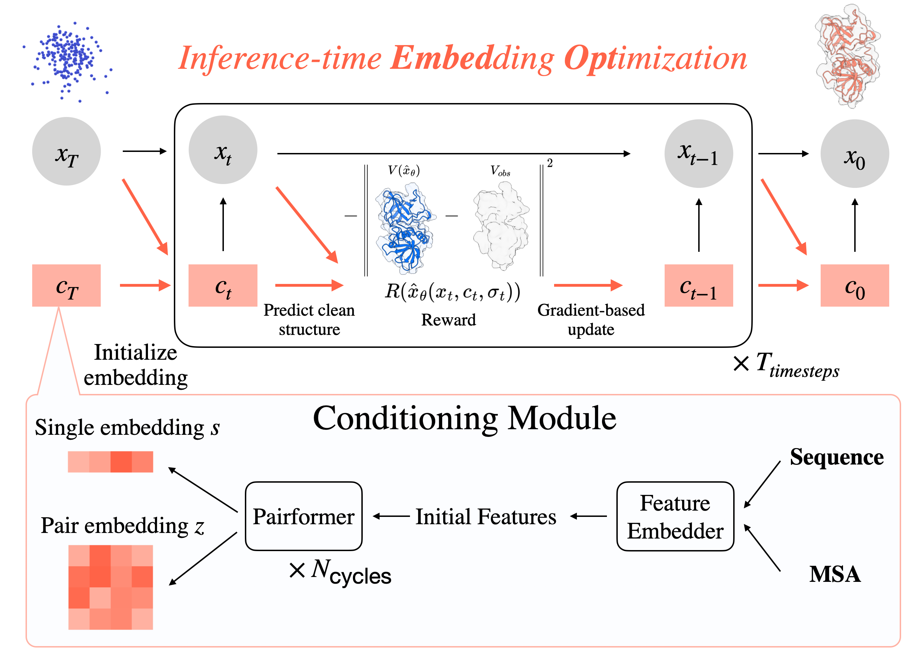
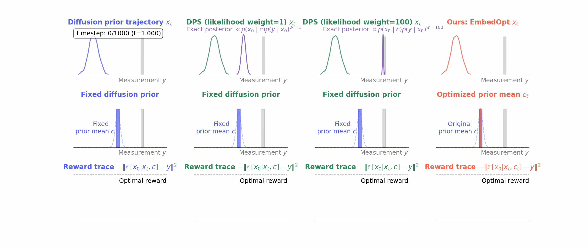
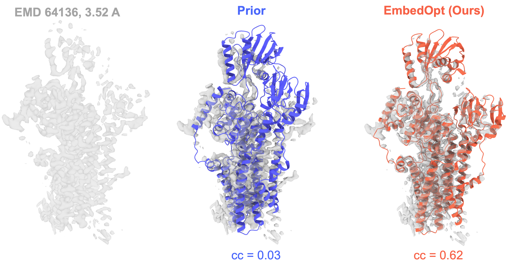

# EmbedOpt

<div align="center">

### **Robust Inference-Time Steering of Protein Diffusion Models via Embedding Optimization**

[](https://arxiv.org/abs/2602.05285)

*Optimize trunk embeddings of a frozen protein diffusion model toward any differentiable reward — no retraining required.*



<sub><em>Methodology schematic of EmbedOpt.</em></sub>



<sub><em>Unlike coordinate-space steering (DPS), EmbedOpt shifts the prior itself — yielding smoother, more regularized trajectories.</em></sub>

</div>

---

## Overview

EmbedOpt extends [Protenix](https://github.com/bytedance/Protenix) (an AlphaFold3 implementation) with reward-guided sampling at inference time. Rather than modifying diffusion noise or retraining the model, EmbedOpt directly optimizes the trunk embeddings (`s_trunk`, `z_trunk`) to maximize a reward — such as cryo-EM density correlation or inter-residue distance satisfaction.

Three sampling strategies are supported:

| Method | Description |
|--------|-------------|
| `base` | Unguided sampling ; supports loading pre-optimized embeddings |
| `dps` | [Diffusion Posterior Sampling](https://arxiv.org/abs/2209.14687) - optimizes noisy coordinates using reward gradient at each diffusion step |
| `embedopt` | **Our method** — optimizes embeddings `s_trunk`/`z_trunk` using reward gradient at each diffusion step |

---

## Installation

```bash
pixi install
```

<details>
<summary>Prerequisites and details</summary>

Install [pixi](https://pixi.sh) if you haven't already:

```bash
curl -fsSL https://pixi.sh/install.sh | bash
```

Run commands inside the environment without activating a shell:

```bash
pixi run python your_script.py
```

Or activate a persistent shell:

```bash
pixi shell
```

**Adding dependencies** — from conda-forge (preferred for compiled/scientific packages):
```bash
pixi add numpy openmm
```

From PyPI:
```bash
pixi add --pypi some-package
```

After adding a dependency, commit both `pyproject.toml` and `pixi.lock` so others get the exact same environment.

</details>

---

## Examples

### Real Cryo-EM Map Tutorial

<p align="center">
  
</p>

Step-by-step walkthrough steering EmbedOpt with a real cryo-EM density map (EMD-64136, 3.52 Å, 9UGC_A). The map, reference structure, and sequence are already included in the folder.

→ [`examples/real_map_tutorial/`](examples/real_map_tutorial/README.md)

---

### Synthetic Cryo-EM Map Benchmark

Reproduces the synthetic map benchmark from the paper: 77 PDB proteins paired with 5 Å synthetic density maps, comparing `embedopt`, `dps`, and `base` across 8 learning rates. Requires a SLURM cluster and Phenix for map–model validation.

→ [`examples/synthetic_map_benchmark/`](examples/synthetic_map_benchmark/README.md)

---

### AF Distance Constraint Benchmark

Reproduces the distance-constraint steered diffusion benchmark on the 24-system Distance-AF set, with learning-rate and diffusion-step sweeps. Requires a SLURM cluster.

→ [`examples/AF_distance_benchmark/`](examples/AF_distance_benchmark/README.md)

---

## Correspondence

Minhuan Li · [minhuanli@flatironinstitute.org](mailto:minhuanli@flatironinstitute.org)  
Luhuan Wu · [luhuanwu0@gmail.com](mailto:luhuanwu0@gmail.com)

---

## Citation

If you use EmbedOpt in your work, please cite:

```bibtex
@article{li2026robust,
  title={Robust Inference-Time Steering of Protein Diffusion Models via Embedding Optimization},
  author={Li, Minhuan and Han, Jiequn and Cossio, Pilar and Wu, Luhuan},
  journal={arXiv preprint arXiv:2602.05285},
  year={2026}
}
```
